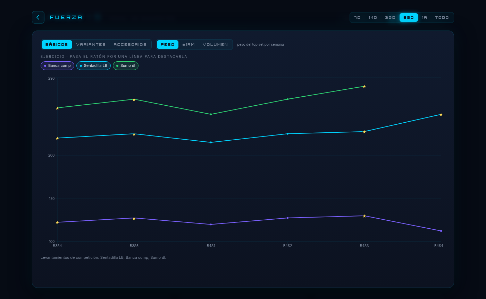

# Jarvis — Wellness & Strength Dashboard

A personal analytics cockpit that consolidates health and training data for a competitive
powerlifter into a single dark-themed dashboard: **readiness, HRV, sleep, training load,
strength progression, bodyweight** and the **correlations** between them — read at a glance.

Data flows from Intervals.icu and Google Forms into a Google Sheet "hub"; Python pipelines
consolidate it, a FastAPI backend serves it, and a React + Recharts SPA renders it entirely
on the client.


## Highlights

- **Readiness hero** — 0–100 score with colour bands and threshold markers.
- **HRV** — coloured by zone, dynamic streaks, and a "your normal range" tooltip.
- **Sleep** — measured against a 7.5 h goal, separating *time in bed* from *time asleep*
  (i.e. sleep-onset latency), so untracked nights don't inflate the numbers.
- **Load** — uses **sRPE** (session-RPE × number of sets), a sport-science-validated metric,
  instead of raw tonnage; percentile bands are computed over the athlete's **own history**.
- **Strength** — top-set weight per week per lift, **all-time PR stars ★**, and accessories
  grouped by muscle pattern with click-to-drill-down.
- **Bodyweight** — robust weekly rate (kg/week) across 4/6/12-weigh-in windows plus a
  historical rate, an **ETA to goal**, and weigh-in dots coloured against the moving-average trend.
- **Correlations** — Spearman, grouped into *lifestyle* and *training*, each with a strength
  label and a **plain-language, deterministic takeaway** (no LLM involved yet).

## Panels in detail

| Strength (PR stars ★) | Bodyweight (rate + ETA) | Correlations |
| :---: | :---: | :---: |
|  |  |  |

## Architecture

```
Data sources             Python pipelines         Hub (Google Sheet)      Backend           Frontend
────────────────         ────────────────         ──────────────────      ───────           ────────
Intervals.icu API ─┐
Google Forms (AM/PM)┼─▶ status_pipeline.py ─┐
Excel plan (Drive) ─┤    entreno_pipeline.py ┼─▶ "Health_booster_data" ─▶ FastAPI /data ─▶ React SPA
keep.txt (log)     ─┘                        │   derived_diario,          (gspread RO,      (Vite,
                                             │   entreno_*, rm1, peso      5-min cache)      Recharts)
```

The pipelines **read** the sources and **rewrite** the sheet; the backend starts *afterwards*
(so it never serves stale cache) and exposes `GET /data`; the frontend fetches once and
renders every panel client-side. `run.sh` orchestrates the three steps.

## Tech stack

- **Pipelines:** Python — pandas, gspread, google-auth, requests.
- **Backend:** FastAPI + Uvicorn; read-only gspread client with a 5-minute cache.
- **Frontend:** Vite, React 18, TypeScript, Tailwind, Recharts.

## Getting started

```bash
cp .env.example .env      # fill in your keys: Intervals.icu, Google service account, sheet IDs
./run.sh                  # 1) pipeline  2) backend :8099  3) frontend :5173
```

The Python venv is built from `requirements.txt`; the frontend needs `npm install` inside
`dashboard/frontend`. `./run.sh --no-pipeline` serves without re-fetching data.

## Roadmap

- **Phase 1 — Core dashboard** ✅ — 7 fixed panels, dark theme, shareable per-panel deep links.
- **Phase 2 — "Jarvis" chat** — natural-language / voice queries → an LLM returns an ad-hoc chart or answer.
- **Phase 3 — Automate the pipeline** — cron / CI / Cloud Run.
- **Phase 4 — Proactive insights** — alerts on HRV drops and the like.

## Notes

- UI, code and comments are in **Spanish** (it's a personal tool).
- Credentials and raw data (`.env`, the Google service-account JSON, the training log) are
  **git-ignored** — see `.env.example` for the expected configuration.
