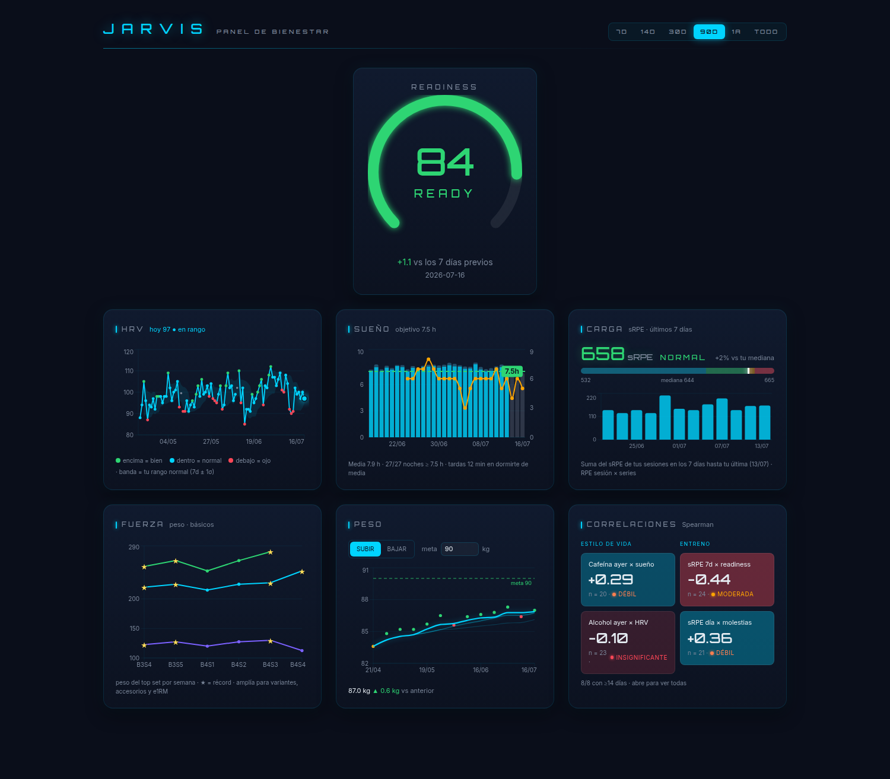
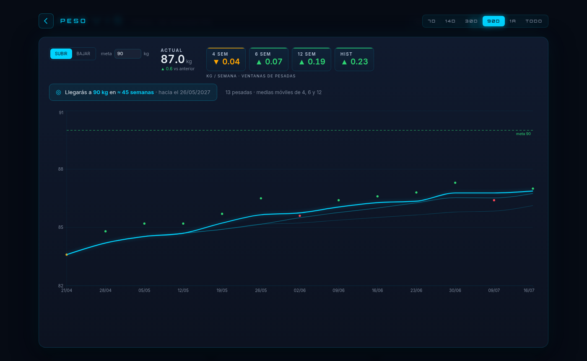
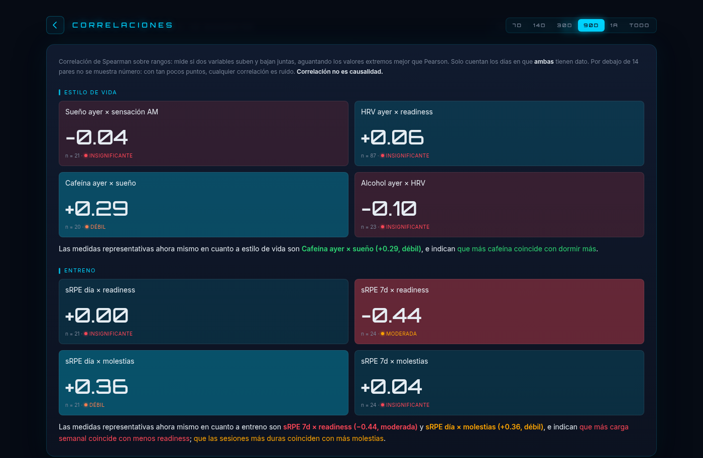
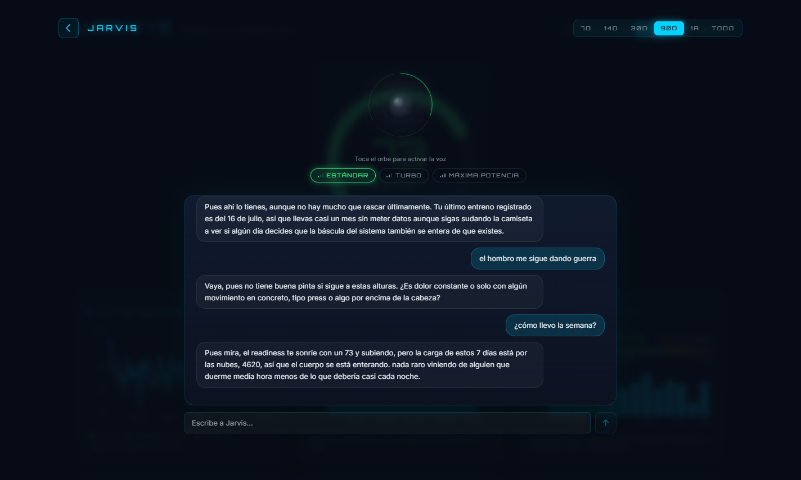

# Jarvis — Wellness & Strength Dashboard

A personal analytics cockpit that consolidates health and training data for a competitive
powerlifter into a single dark-themed dashboard: **readiness, HRV, sleep, training load,
strength progression, bodyweight** and the **correlations** between them — read at a glance.

Data flows from Intervals.icu and Google Forms into a Google Sheet "hub"; Python pipelines
consolidate it, a FastAPI backend serves it, and a React + Recharts SPA renders it entirely
on the client.



## Highlights

- **Readiness hero** — 0–100 score with colour bands and threshold markers.
- **HRV** — coloured by zone, dynamic streaks, and a "your normal range" tooltip.
- **Sleep** — measured against a 7.5 h goal, separating *time in bed* from *time asleep*
  (i.e. sleep-onset latency), so untracked nights don't inflate the numbers.
- **Load** — uses **sRPE** (session-RPE × number of sets), a sport-science-validated metric,
  instead of raw tonnage; percentile bands are computed over the athlete's **own history**.
- **Strength** — top-set weight per week per lift, **all-time PR stars ★**, and accessories
  grouped by muscle pattern with click-to-drill-down.
- **Bodyweight** — robust weekly rate (kg/week) across 4/6/12-weigh-in windows plus a
  historical rate, an **ETA to goal**, and weigh-in dots coloured against the moving-average trend.
- **Correlations** — Spearman, grouped into *lifestyle* and *training*, each with a strength
  label and a **plain-language, deterministic takeaway** (no LLM involved yet).

## Panels in detail

| Strength (PR stars ★) | Bodyweight (rate + ETA) | Correlations |
| :---: | :---: | :---: |
|  |  |  |

## Architecture

```
Data sources             Python pipelines         Hub (Google Sheet)      Backend           Frontend
────────────────         ────────────────         ──────────────────      ───────           ────────
Intervals.icu API ─┐
Google Forms (AM/PM)┼─▶ status_pipeline.py ─┐
Excel plan (Drive) ─┤    entreno_pipeline.py ┼─▶ "Health_booster_data" ─▶ FastAPI /data ─▶ React SPA
keep.txt (log)     ─┘                        │   derived_diario,          (gspread RO,      (Vite,
                                             │   entreno_*, rm1, peso      5-min cache)      Recharts)
```

The pipelines **read** the sources and **rewrite** the sheet; the backend starts *afterwards*
(so it never serves stale cache) and exposes `GET /data`; the frontend fetches once and
renders every panel client-side. `run.sh` orchestrates the three steps.

The assistant adds two optional services next to it, both laptop-only:

```
                       ┌─────────────────── FastAPI :8099 ───────────────────┐
Browser (React) ──────▶│ /chat/stream  router → tools → SSE                  │
  orb + chat           │ /hilo         shared conversation thread            │
      ▲                └──────┬──────────────────────┬─────────────────────-─┘
      │                       │                      │
      │                  SQLite jarvis.db      Anthropic API
      │                  (thread + facts)      (Haiku router, Sonnet replies)
      │
      └── audio ── Voice service :8123 ── ElevenLabs (v3) ─┐
                        └── XTTS local ────────────────────┴─ fallback chain

Local listener (own process) ── mic → VAD → Whisper → /chat/stream → :8123
```

## Jarvis — the voice assistant

You talk to the dashboard. It answers out loud, in character, and can drive the UI —
"open my sleep panel" opens it and comments on what you're seeing. The interesting part
wasn't wiring an LLM in; it was getting the **latency** low enough that talking to it
feels like talking to someone.

| Thinking (the orb is the interface) | A real exchange |
| :---: | :---: |
|  |  |

*Unedited output. Watch the second one. It owns the gap in the data rather than inventing
around it — "your last logged session is 16 July, so you've gone nearly a month without
entering anything, however much you've been sweating". It drops the banter the moment a
sore shoulder comes up and asks a useful follow-up instead. And it closes by putting the
real numbers together: readiness at 73 and rising, but a 4620 sRPE week on half an hour
less sleep than he needs, most nights.*

**Everything below is measured, not estimated.** The same long reply, end to end:

| Text-to-speech engine | Time to speak | Notes |
| :-- | --: | :-- |
| Qwen3-TTS 1.7B (local) | 113 s | Fell off a cliff on long text: the KV cache overflowed 6 GB of VRAM and spilled to system RAM |
| Qwen3-TTS 0.6B (local) | 30 s | Cliff gone, but a flat ~2× real-time floor |
| XTTS-v2 (local) | 6.3 s | Generates at ~0.3× real-time — faster than it speaks |
| **ElevenLabs v3** | **1.4 s** | The one in use; local XTTS stays as a fallback |

Three further things closed the gap between "answer generated" and "voice heard":

- **Streamed replies (SSE).** The backend emits text as the model writes it, and the
  browser sends each *finished sentence* to the TTS. Speech starts on sentence one instead
  of after the last token. Prompt caching was already working — what costs time is how much
  the model writes, not the prompt.
- **A router in front.** A small fast model (Haiku) classifies the message first, alone.
  A greeting never reaches the expensive model at all. Running the router *in parallel*
  with the main call looked obviously better and was four times slower — both requests
  fight inside the same process.
- **Conversational fillers.** A pre-recorded "let me look at that" covers the remaining
  silence. Writing them per-message fit the context better, but they then had to be
  synthesised with the fast, flat model to arrive in time, and clashed with an ironic
  answer. Recorded once with the expressive model, they keep the character.

**Listening lives outside the browser.** Chrome suspends the Web Speech API the moment the
tab stops being visible, so a separate local process owns the microphone: VAD trims speech
from silence, `faster-whisper` transcribes only the speech, and the command goes to the same
backend endpoint the UI uses. Browser and microphone share one conversation thread, so
speaking and typing are the same conversation.

Cost is roughly **$6–12/month** on pay-as-you-go — about two cents per spoken reply.

### Bugs that return a number instead of an error

The failures worth writing down here are the ones that never throw. They come back as a
plausible figure, and the only way to catch them is to ask where the figure came from.

- **A best bench press of 106 kg that belonged to no exercise.** Looking up a lift matched
  by substring, so "banca" swept competition bench, larssen and a complex into one pile and
  reported the maximum across all three. Variants are now answered one at a time, with the
  siblings listed separately.
- **A squat that restarted at 125 kg.** The coach put a 2 cm heel wedge under it for an
  injury and removed it months later, spelling the lift differently on the way back. Same
  movement, new name, so the panel drew a line starting from scratch — 3 sets instead of 24,
  and a personal best of 125 kg instead of 170. Merging exercise names is dangerous in the
  other direction too, so the alias table is exact and earned by hand; the wedge version is
  still kept separate, because that one really was a different lift.
- **Two different "7-day load" numbers, both correct.** The dashboard closes the window on
  the last session, the assistant closed it on today, so after a rest week one said 622 and
  the other 385. Neither was wrong. The assistant now carries both and has to say which is
  which, because agreeing with whoever is holding the screen is not an answer.
- **A voice detector that could not be cut off, or could not stop cutting off.** Used in a
  car at 100 km/h it interrupted itself constantly. The noise floor was being erased on
  every sentence, so the threshold never adapted no matter how long you waited, and
  "sustained 220 ms" allowed 250 ms gaps, which fluctuating road noise satisfies trivially.
  Simulated on a car-shaped signal: one false cut before, none after. Fixing the floor then
  pushed the threshold to 0.2-0.3 against a measured voice of 0.04-0.08 — trading one
  failure for its opposite — so it is capped. The thresholds have a test now, which they
  never had, including one that pins a limitation rather than hiding it: a hard breath near
  the microphone does cross the quiet-room threshold. The detector measures energy, not
  timbre.

### Also worth a look

- **Light by default, complete on demand.** The state briefing is rebuilt on every message,
  so it stays short; a `refrescar` tool drops the cache and returns everything the panels
  show — strength by block, the load series, sleep efficiency, the correlation matrix — for
  about 460 tokens, paid only when a number is disputed.
- **It knows what time it is.** The prompt carried the date but not the hour, and the
  conversation arrived with no timestamps, so "I have work now, German this afternoon"
  turned into being sent to German five minutes later. Messages are stamped, and it also
  knows how long since you last spoke: the thread is daily, so without that, coming back
  after lunch and after a week looked identical.

- **Tool calls split by who can run them.** Read tools (query a day, a lift) execute on the
  server; UI tools (open a panel, highlight) are returned to the browser as a list of
  actions. One response is `{texto, acciones}`, so a guided tour needs no extra machinery.
- **Memory** is a SQLite thread plus durable facts the model chooses to save, both pushed
  into the system prompt rather than queried by the model.
- **The personality has brakes.** The prompt spends more words on *when to stop being
  funny* — injuries, bad news — than on being funny. An assistant that jokes at the wrong
  moment is worse than one with no personality at all.

## Tech stack

- **Pipelines:** Python — pandas, gspread, google-auth, requests.
- **Backend:** FastAPI + Uvicorn; read-only gspread client with a 5-minute cache; SSE for
  streamed replies; SQLite for conversation and memory.
- **Frontend:** Vite, React 18, TypeScript, Tailwind, Recharts; canvas-rendered voice orb.
- **Assistant:** Anthropic API (Haiku for routing, Sonnet for replies), ElevenLabs TTS with
  a local XTTS-v2 fallback, `faster-whisper` + WebRTC VAD for the local listener.

## Getting started

```bash
cp .env.example .env      # fill in your keys: Intervals.icu, Google service account, sheet IDs
./run.sh                  # 1) pipeline  2) backend :8099  3) frontend :5173
```

The Python venv is built from `requirements.txt`; the frontend needs `npm install` inside
`dashboard/frontend`. `./run.sh --no-pipeline` serves without re-fetching data.

## Roadmap

- **Phase 1 — Core dashboard** ✅ — 7 fixed panels, dark theme, shareable per-panel deep links.
- **Phase 2 — "Jarvis" assistant** ✅ mostly — voice in and out, streamed replies, panel
  control, memory. Still open: ad-hoc charts on request, and in-chart highlighting.
- **Phase 3 — Automate the pipeline** — cron / CI / Cloud Run.
- **Phase 4 — Proactive insights** — alerts on HRV drops and the like.

## Notes

- **UI, code and comments are in Spanish**, deliberately: it's a personal tool for a
  Spanish speaker, and the assistant's whole personality lives in Spanish prose. This
  README is the English front door to it.
- Credentials and raw data (`.env`, the Google service-account JSON, the training log) are
  **git-ignored** — see `.env.example` for the expected configuration.
